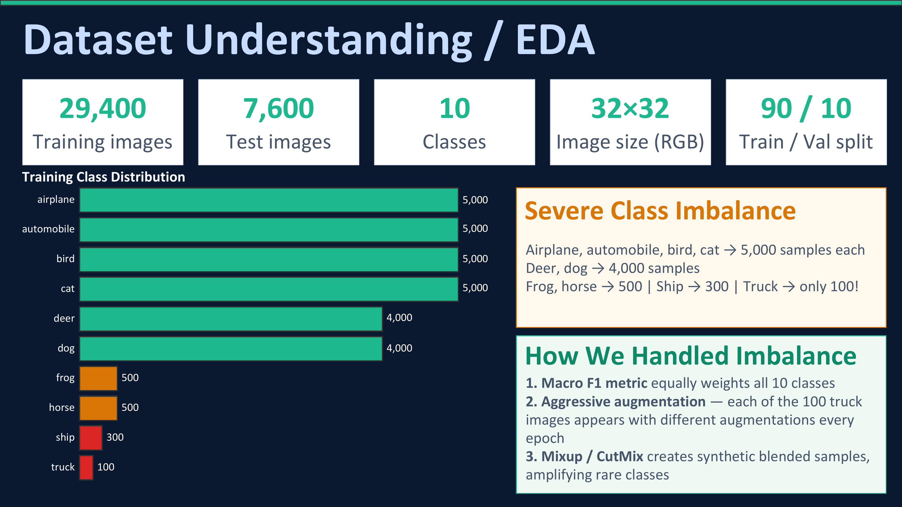
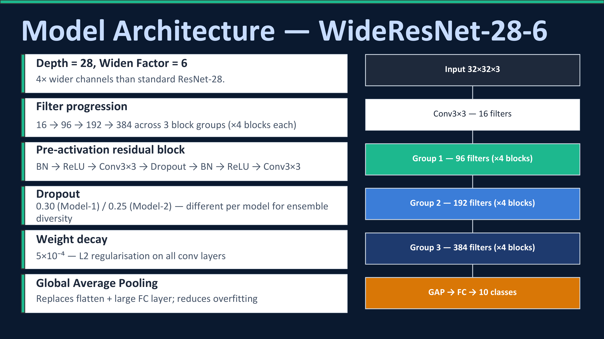
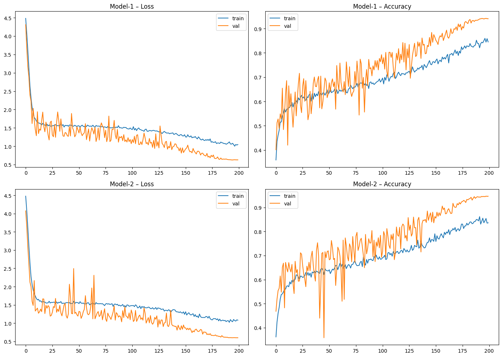

# ShiftGuard-10: Robust Image Classification Challenge

A robust 10-class image classification project developed as part of **EE708** under **Prof. Rajesh M. Hegde**. The project focuses on improving model performance under **distribution shift** and **severe class imbalance**.

## Overview

ShiftGuard-10 contains **32×32 RGB images** belonging to 10 classes:

`airplane, automobile, bird, cat, deer, dog, frog, horse, ship, truck`

The main challenge is that the test distribution differs from the training distribution, making standard image classification approaches prone to poor generalization. The dataset also contains strong class imbalance, with the **truck class having only 100 training samples**.

The model is evaluated using **Macro F1 Score**, giving equal importance to all classes.

## Approach

The solution was developed progressively, starting from a standard CNN baseline and improving it through architecture, augmentation, and inference techniques.

### Model

* **WideResNet-28-6** implemented in **PyTorch**
* Pre-activation residual blocks
* Global Average Pooling
* Weight decay for regularization

### Data Augmentation

* **RandAugment**
* Random horizontal flipping and reflect-padded cropping
* **Cutout**
* **Mixup**
* **CutMix**

These techniques were used to improve robustness to distribution shift and reduce the impact of class imbalance.

### Training

* **SGD with Nesterov momentum**
* Batch size: **128**
* **200 epochs**
* Label smoothing: **0.05**
* 5-epoch linear warmup followed by **cosine annealing**
* Two independently trained models with different seeds and dropout rates

### Ensemble & TTA

Two WideResNet models were combined using probability averaging. Each model used **15-pass Test-Time Augmentation (TTA)** with transformations such as flipping, cropping, and image jitter.

This resulted in **30 effective prediction paths** across the two models.

## Results

Model performance was evaluated using **Macro F1 Score**, with separate reporting for validation and test performance.

| Approach | Validation Macro F1 | Test Macro F1 |
|:---|---:|---:|
| Baseline CNN | 67.3% | — |
| Improved Augmentation | 72.1% | — |
| Single WRN-28-6 | 87.84% | — |
| Model 1 + TTA | 89.87% | — |
| Model 2 + TTA | 92.48% | — |
| **Ensemble + TTA** | **90.90%** | **88.30%** |

The final ensemble achieved **90.90% validation Macro F1** and **88.30% test Macro F1**.

Probability averaging combines predictions from both independently trained models to improve robustness under distribution shift.

*Note: Test results for intermediate approaches are not reported.*

## Project Visuals

### Dataset Distribution and Class Imbalance



### WideResNet-28-6 Architecture



### Training and Validation Curves




## Repository Structure

```text
shiftguard10-robust-classification/
│
├── 20_Code.ipynb
│
├── docs/
│   ├── Project_Report.pdf
│   └── Project_Presentation.pdf
│
├── assets/
│   ├── dataset_imbalance_eda.png
│   ├── wideresnet_architecture.png
│   ├── augmentation_strategy.png
│   ├── training_curves.png
│   ├── ensemble_tta_workflow.png
│   └── final_results_summary.png
│
└── README.md
```
Replace the placeholder code filename with the actual notebook/script you upload.

## Dataset

The dataset consists of:

* **29,400 training images**
* **7,600 test images**
* **10 classes**
* Image resolution: **32×32 RGB**
* Train/validation split: **90/10**

The training data is highly imbalanced, making Macro F1 especially important for evaluating the model.
The competition dataset is not included in this repository. The notebook expects the dataset to be available through the Kaggle competition input directory.

## Key Takeaways

The experiments showed that:

* Strong and diverse augmentation is important for handling distribution shift.
* **WideResNet-28-6** provided substantially better performance than the initial CNN baseline.
* Ensemble diversity through different seeds and dropout settings improved robustness.
* **TTA + probability averaging** further improved prediction stability.
* 
## Project Documents

* [Detailed Project Report](docs/Project_Report.pdf)
* [Project Presentation](docs/Project_Presentation.pdf)
* [Implementation Notebook](20_Code.ipynb)

## Technologies

**Python · PyTorch · NumPy · Pandas · Matplotlib · Deep Learning · Computer Vision**

## Project Information

**Course:** EE708
**Instructor:** Prof. Rajesh M. Hegde
**Project:** ShiftGuard-10: Robust Image Classification Challenge
**Duration:** Jan 2026 – Apr 2026
